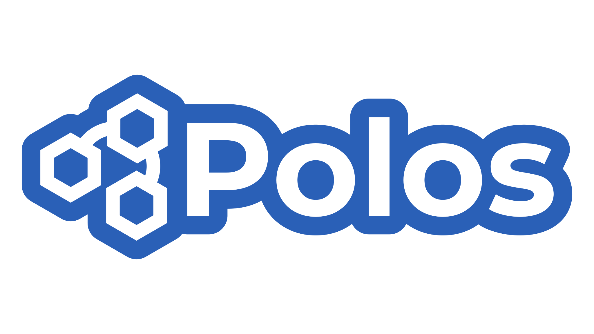

# [](https://github.com/PolosGames/Polos/blob/master/LICENSE)

A C++ game engine project.

**Roadmap** can be found in [this](https://trello.com/b/frG6m0AQ) link.

**Coding Guidelines** can be found in [Polos Engine C++ Coding Guidelines](https://bit.ly/3YpjIqH).

### Supported Platforms

- Windows

### To Build

You need:
- CMake 3.25 or newer
- vcpkg (Need to set `VCPKG_ROOT` environment variable to the installation of the vcpkg)
- [OPTIONAL]
    - Workspace file can be obtained by running `./get-workspace.sh`
    - Either curl or wget is required

### Runtime and versions

The runtime builds as one `polos` shared library, defined in
`Source/Runtime/CMakeLists.txt`. Directory-local CMake files contribute sources;
all runtime headers are accessible across areas. See [Runtime layout](Source/Runtime/README.md).

The root `VERSION` file starts at `0.0.1` and controls the CMake project version,
shared-library version, `POLOS_VERSION*` macros, and engine build information.
Increase it for each versioned change and commit it with that change:

```sh
cmake -P Scripts/bump_version.cmake              # patch, e.g. 0.0.1 -> 0.0.2
cmake -DPART=minor -P Scripts/bump_version.cmake # resets patch to zero
cmake -DPART=major -P Scripts/bump_version.cmake # resets minor and patch
```

Builds keep a separate local counter in the build directory; no-op builds do not
advance it or modify the tracked semantic version.

### Resources

Resources load from `Resources` beside the executable. Stable resource IDs and relative
paths are listed in `Source/Resource/resources.json`; see the
[resource loading guide](Source/Runtime/polos/resource/README.md) for lookup and caching rules.

### Nightly builds

The `Nightly dummy` GitHub Actions workflow builds Linux x64 Release from the repository's default branch
(currently `master`)
at 00:17 UTC (03:17 Istanbul) each day, runs the unit tests, and publishes the dummy
example, engine libraries, shaders, textures, and checksums as a GitHub prerelease.
Tags use `v<VERSION>-nightly.<YYYYMMDD>.<run>.<attempt>` and point to the exact built
commit. It can also be dispatched manually from the default branch; other refs are skipped.
It follows the default branch automatically if it is renamed to `main`.
The workflow needs to be on the repository's default branch for scheduled runs.

Extract the archive and run `./dummy` from its directory with a Vulkan 1.3 capable
driver and a desktop session. Optional model resources under `Source/Resource/Models`
are included when present; the Suzanne model currently referenced by the dummy is
not checked into the repository.
