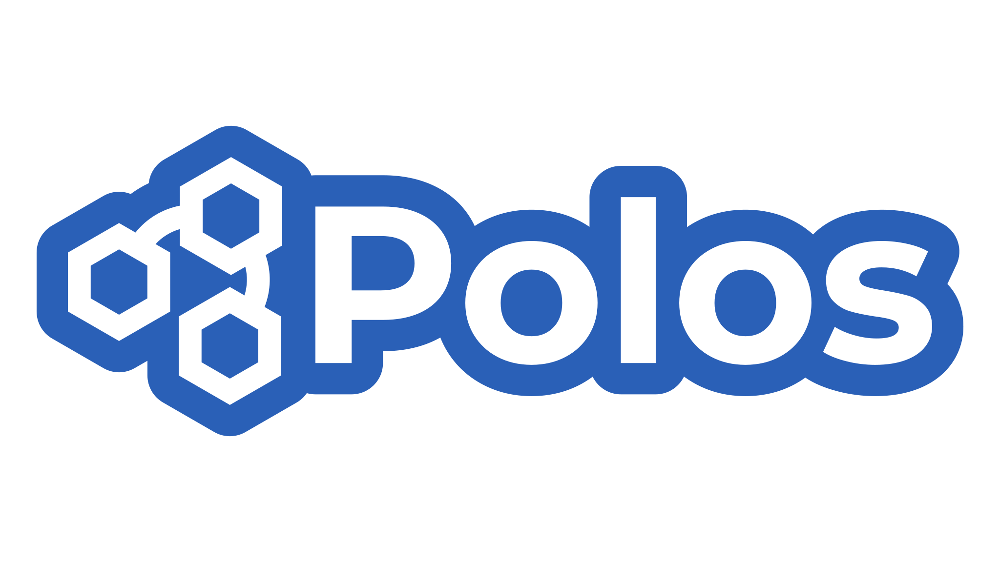

# Polos

Polos is a C++23 game engine for Windows and Linux on x64. It provides a Vulkan
renderer, an entity-component system, asset loading, and an application loop.
Games are written in C++ and can use the engine from its source tree or through
an exported SDK.

The runtime builds as one shared library, `polos.dll` on Windows and `libpolos.so`
on Linux. Applications own their game logic, scenes, and resources.

## Engine

- **Rendering** uses Vulkan 1.3, with mesh and material caches, lighting,
  instanced drawing, and GPU frustum culling.
- **Scenes** contain entities and components for transforms, cameras, meshes,
  and lights. Systems update those components each frame. Scenes can be saved
  to and loaded from YAML.
- **Assets** include glTF models, images, and materials. Material textures retain
  their glTF sampler settings. The renderer uploads loaded assets into its caches.
- **Input and events** provide keyboard and mouse state, window events, and
  callbacks for engine and rendering updates.
- **UI** uses Dear ImGui directly. Polos initializes its context and handles the
  GLFW and Vulkan backends. Applications call `ImGui::*` during rendering updates.
- **Logging and profiling** provide engine and application logs, with optional
  Tracy instrumentation.

## Writing an application

An application implements `ILiveLayer`, or derives from `BaseLiveLayer`, and
returns it from `polos::CreateApplication`. Including `polos/core/polos_main.hpp`
provides the executable entry point.

Polos creates the window, loads the resource catalog, and initializes rendering
before calling the application's `Create()`. Create or load a scene there so
the renderer has an active camera.

Subscribe to `EngineUpdate` for gameplay and `RenderUpdate` for ImGui calls.
Both events provide frame delta time. The engine runs until the window closes
or an `EngineTerminate` event is dispatched, then calls `Destroy()` and shuts down.

## Resources

Each application keeps its assets in a `Resources/` directory beside its
executable. `Resources/resources.yaml` maps resource IDs to paths within that
directory. The engine loads the catalog before starting the application.

`ResourcePreprocessor` scans a project's `Resources/` directory and generates
the resource catalog and model and material YAML descriptors. Run it after
adding or changing source assets.

Engine shaders live in `Source/Resources/Shaders`. The build compiles them to
SPIR-V and embeds their byte arrays in the runtime.

## Building

Use a C++23 compiler, CMake 3.25 or newer, Ninja, and a bootstrapped vcpkg
installation. Set `VCPKG_ROOT` to the vcpkg directory. Install the Vulkan SDK
and set `VULKAN_SDK`, or provide Vulkan development headers, the loader, and
glslang through your system.

On Windows, run the scripts from an x64 Visual Studio Developer PowerShell.

To build and run an example from `Examples/`, run from the repository root:

```sh
bash Scripts/Linux/run_project.sh <project> [preset]
```

```powershell
./Scripts/Windows/run_project.ps1 -Project <project> -Preset debug-runtime
```

The default preset is `debug-runtime`. Use `release-runtime` for Release.
The runner generates resource YAML, builds the selected application, and launches
it from `out/bin/<preset>/<project>/`. Build files go under `out/build/`.

## Using the SDK

Export the SDK into a standalone project's directory:

```sh
bash Scripts/Linux/export_sdk.sh /path/to/project
```

```powershell
./Scripts/Windows/export_sdk.ps1 -Destination C:/path/to/project
```

The export defaults to `release-sdk`. Pass `debug-sdk` as the second argument
on Linux or use `-Preset debug-sdk` on Windows for a Debug SDK.

The scripts place headers, runtime libraries, Windows import libraries, and
`tools/ResourcePreprocessor` in the project's `sdk/` directory. An existing
`sdk/` is replaced after a successful export. A ZIP is also written to
`out/packages/`. Running the export script without a destination produces the ZIP.

Add `sdk/include` to your application's include paths and link against Polos.
Make the SDK's runtime libraries available beside the executable or through
its runtime search path. The destination machine needs a Vulkan 1.3-capable driver.

Generate the standalone project's resource descriptors with:

```sh
/path/to/project/sdk/tools/ResourcePreprocessor /path/to/project
```

On Windows, use `sdk/tools/ResourcePreprocessor.exe`. Copy the application's
`Resources/` directory beside its executable before running it.

## Contributing

The project uses the MIT license. Commit prefixes are documented in
[CONTRIBUTE.md](CONTRIBUTE.md). The project also maintains a
[roadmap](https://trello.com/b/frG6m0AQ) and
[C++ coding guidelines](https://bit.ly/3YpjIqH).

## AI Usage

This repository's AI tool usage is limited to create Unit/Component tests, README files, CI units, Scripts and some CMake files.
